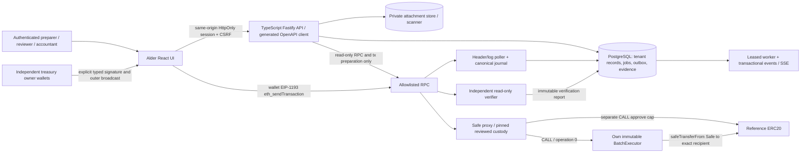

# Alder Treasury — engineering blueprint

## 1. Status, approved scope and interpretation

**Proposed engineering specification, not application implementation or verified capability.** Deliver a complete product team's contractor-payout workflow: private payable intake → business review → immutable exact batch → independent treasury signatures → actual local EVM execution → independently reconciled canonical token effects → evidence and recovery. All 13 original Alder screens remain release scope. Thin slices are integration milestones, not an MVP scope reduction. No competitor benchmarks, novel-protocol validation, reuse of private projects, simulation badge, real-funds/audit/certification assertion or fiat/legal settlement claim.

Authority: ENGINEERING-CONTRACT.md, shared PORTFOLIO-QUALITY-CHARTER.md, agreed WEB3-PORTFOLIO-BRIEF.md and original treasury HTML/screens/design notes. Preserve warm neutral canvas, white surfaces, bronze actions, quiet borders, Segoe UI/Helvetica Neue, precise monochrome identifiers and task-specific desk/split/table/timeline compositions. Design acknowledgements become real wallet interactions, not a backend emulation. Remove preview-only controls from product navigation; keep every exact screen ID. Real onboarding/session/recovery/help are additional production routes, not replacements for the 13 screens. A local network label is accurate context, not a repetitive disclaimer badge.

Reference data preserves Northstar, Maya/Eli/Noah/June and the October cycle as explicit **seed fixtures**; PAY-1041 etc are display references, internal records use UUIDs, chain payment IDs are random bytes32 and not hashes of invoices. Default asset is a newly deployed local six-decimal reference token; do not represent it as official USDC or copy sample addresses into deployment manifests. Attachment evidence is manually entered/imported, not OCR or a dependency on the documents flagship.

This stream only writes treasury-blueprint.md, treasury-contracts.json and treasury-sources.md. Official retrieval was read-only. No install/build, server, repository creation, chain startup, deployment, wallet connection/signature, public action or spend occurred. Planned commands/tests below are **not run**. JSON structural validation is distinct from application/security validation.

## 2. Concrete architecture and ADRs



Trust/process boundaries: browser code/wallet and API identity are different; business DB cannot sign for Safe; Safe authority does not depend on app availability; executor enforces only its own immutable route. RPC is untrusted observation with chain-instance/deployment allowlists and disagreement holds. Indexer is not independent verifier. Verifier has read-only RPC + frozen manifest input and writes an immutable report through a narrow result interface; it never accepts the app's paid boolean as evidence. Private object service has no public ACL and chain has no private attachment bytes.

| ADR | Recommendation / reason | Alternative or blocking check |
|---|---|---|
| Custody | Integrate Safe, do not invent multisig. Inspection candidate v1.4.1 source, pinned commit/bytecodes and independent review before use. Initialize proxy atomically 2-of-3 EOA owners; setup initializer to=0, data empty, fallbackHandler=0, payment=0; no guard/modules. | Candidate is not an assertion of latest/security clearance. Review advisories, deployment/singleton/factory and initialization source; approve immutable commit/hashes at TR-D-CUSTODY. Never leave uninitialized proxy. |
| Payment boundary | Own non-upgradeable BatchExecutor per immutable Safe/token pair; typed ABI and whole-batch rollback; no signature verification/custom custody inside executor. | Safe direct transfers alone miss required payment-ID/expiry/atomic operational boundary. Global guard/module is different scope, not required. |
| CALL vs delegation | Safe CALL executor, executor CALL token transferFrom from Safe. No application DELEGATECALL or MultiSend helper. | Delegating executor would operate in Safe storage/context and fail intended msg.sender/storage authority model; never swap operation silently.[2] |
| App stack | TypeScript strict, React19/Vite, Fastify, PostgreSQL16, viem ABI/typed-data adapter; ordinary filesystem private object adapter in reference deployment. | Exact package patches/lockfiles and compatibility are TR-D-PIN; Safe SDK only if its exact pin supports approved artifacts. Build own business app, not copied custody crypto. No paid SaaS required. |
| Contracts/toolchain | Candidate Solidity0.8.24 with explicit shanghai target, OZ5.0.2 SafeERC20/ReentrancyGuard, Foundry1.5.1 observed commit. | No implementation built; compiler/dependency/remapping compatibility and bytecode reproducibility are gates. Do not claim candidate is newest. |
| Worker boundary | Separate Node API/indexer/verifier/worker processes with short-lived scoped credentials and PG outbox; no mandatory Redis. | Polling plus durable backfill, not WS-only indexing. No common shared runtime with ML/documents products. |
| Auth | Real session from self-hostable identity adapter; local password/WebAuthn session implementation with reviewed library or pinned self-hosted OIDC integration chosen at bootstrap. Accounts provisioned locally, no paid identity dependency. | Production must exercise real authentication/onboarding/reset/revoke; role-switch preview is not auth. Exact auth adapter pin reviewed before implementation; no invented credentials. |

Proposed independently runnable repository (not created): `apps/web`, `apps/api`, `services/indexer`, `services/verifier`, `services/worker`, `contracts/src`, `contracts/test`, `contracts/script`, `packages/openapi`, `packages/abi`, `packages/intent-vectors`, `db/migrations`, `ops/local`, `ops/runbooks`, `tests/browser`, `tests/fault`, `evidence/treasury/{release}`. Each release locks compiler/EVM/Foundry/Node/browser/PG versions, OS/container digests, all package/transitive pins, dependency licenses/notices, ABI/schema hashes and deployed genesis/proxy/singleton/executor/token bytecodes. No repository/code is authored in this phase.

## 3. Custody / executor protocol specification

### 3.1 Exact authorization and caller flow

Safe custody authenticates owners/current threshold and enforces its Safe transaction nonce.[1][6] Outer broadcaster may be any address holding complete signatures; application routes require workspace owner membership **and** current on-chain owner proof, but custody itself allows external broadcast. This is disclosed, not confused with app RBAC. An observer/relayer sending an already signed Safe transaction is not an owner signature. Reference UI has owners explicitly sign and a selected connected wallet explicitly broadcast; backend stores no owner key, never calls `eth_sign`/unlocked `eth_sendTransaction` as an owner, never impersonates accounts. Automated tests may sign known test keys in an isolated harness, clearly not a backend feature. No live user wallet is connected here.

Freeze intent consists of:

```
Payment = (bytes32 paymentId, address recipient, uint256 amount)
executeBatch(bytes32 batchId, uint64 validAfter, uint64 validUntil,
             bytes32 expectedAuthorityHash, Payment[] items)
```

Executor immutable constructor config: Safe address, token address, expected chain ID, profile/version and maximum100 items. Non-upgradeable reference token has pinned runtime hash; unsupported proxy token/upgrades are rejected by configuration gate. Deployment manifest binds code hashes/genesis, not symbol. Executor rejects value/native payments; asset is immutable and does not need a caller-supplied token field. Independent review must confirm constructors, code-presence checks and no backdoor/admin sweep/arbitrary-call entrypoints.

**Safe typed signature is the authorization.** No separate custom `BatchIntent` signature that could diverge from execution. `SafeTx(address to,uint256 value,bytes data,uint8 operation,uint256 safeTxGas,uint256 baseGas,uint256 gasPrice,address gasToken,address refundReceiver,uint256 nonce)` with Safe's actual domain `EIP712Domain(uint256 chainId,address verifyingContract)`.[1][3] Domain verifyingContract = Safe proxy, not executor; `to` = immutable executor, `value=0`, `operation=0` CALL; `data` = exact ABI encoding above; gasPrice=0/baseGas=0/gasToken=zero/refundReceiver=zero in baseline; signed **nonzero** safeTxGas selected from simulation/estimation plus documented margin. Nonzero safeTxGas changes failure behavior and is itself part of signed payload. Outer sender nonce/maxFee/maxPriorityFee/gas limit are separate EOA envelope fields, not Safe nonce. Outer gas limit must satisfy Safe forwarding overhead; fee-bump must not change signed Safe fields. Re-estimating signed safeTxGas requires new owner signatures, not a UI-only update.

Thus batchId, order, every paymentId/recipient/raw amount, validAfter/validUntil and authority hash are signed through `keccak256(data)`. Asset/executor identity bound through domain, destination and immutable deployment manifest. Compare at freeze/sign/broadcast: independent encoder → calldata decoder → complete ordered manifest; independent typed hash → Safe getTransactionHash at recorded canonical block. Show full addresses, token contract, raw/formatted units, total/count, allowed times in UTC and chain seconds, Safe nonce, all gas/refund fields, operation and current owners/threshold. Browser independently reconstructs instead of blindly signing server-provided bytes. Acknowledgement records intent inspection, not a signature. Account/network changes abandon pending prompt UI and require fresh domain/account checks; existing already-produced signatures are not declared revoked.

Baseline supported signatures: EOA EIP-712 via supported pinned injected desktop wallet `eth_signTypedData_v4`; normalized ECDSA65 with reviewed library, distinct owner and sorted ascending addresses for Safe packed signature rules. No personal_sign/eth_sign fallback, approved-hash shortcuts or contract-owner UI in baseline. Safe candidate's `v=0` contract signature path calls **legacy `isValidSignature(bytes,bytes)`**, while modern ERC-1271 specifies bytes32 signature and magic0x1626ba7e.[1][4] These are not interchangeable. Contract-owner messages are explicitly unsupported until tested adapter/fallback policy, valid magic, revert/state-dependent validity/gas behavior and signature offsets/ordering have separate acceptance. No new executor-level 1271 verifier is needed. EOA-only release meets agreed illustrative owners; no broad smart-account wallet compatibility claim. TR-T-1271 tests refusal, not fabricated successful support.

### 3.2 Allowance and atomicity

1. Separate quorum-authorized Safe CALL to `token.approve(executor, cap)` establishes bounded cap = next batch total. If prior nonzero allowance exists, explicitly signed zero reset precedes new cap; these consume their own Safe nonces and appear as allowance operations, never payable settlement. Freeze payout's nonce **after** allowance operations canonical or reserve nonce sequence visibly. Read actual allowance and token balance at preflight and inclusion. No unlimited allowance.
2. Owner-authorized Safe CALL reaches executor with `msg.sender == immutableSafe`; `safeTransferFrom(token, Safe, recipient, amount)` makes executor the spender. Safe does not push tokens to executor. Treasury funds never sit in executor. An EOA direct call fails even if it has allowance; approval alone never empowers anyone other than the constrained executor path.[7][9]
3. Executor checks chain/config, OnlySafe, nonReentrant, valid times, authority hash, nonempty bounded array, batch unexecuted/uncancelled, no duplicate/used payment IDs, positive checked amounts, recipients !=zero/Safe/executor, checked total <=Safe balance and allowance. Authority hash = keccak256(abi.encode(sortedAscending(getOwners()), getThreshold())); define sorting identically off/on chain. This prevents executing frozen intent under different current owner/threshold snapshot; it is not a signed governance epoch. If same state returns, validity may return unless nonce/expiry/cancel prevents it. All governance uses actual Safe authority, not app settings.
4. Mark batch and **all** IDs before token interactions; on any failure whole executor CALL reverts. For each supported standard transfer, use SafeERC20; compare recipient pre/post exact +amount and Safe pre/post -amount to reject fee/non-exact behavior under stated token trust. Reentrancy guard covers execute/cancel shared mutable state. Emit per-item PaymentExecuted only after exact transfer check; final BatchExecuted includes `intentHash = keccak256(msg.data)` (digest of the exact executor function calldata, not the Safe transaction hash), checked total and count. Verifier independently links this calldata digest to the separate SafeTx hash and signed `data`; never conflate those hashes. Returned false/revert/delta mismatch reverts whole batch including prior transfers/events/ID markers. No partial successful item or per-item catch/continue. Duplicate recipient addresses permitted with exact per-transfer checks; duplicate IDs forbidden.
5. Executor cancellation: `cancelBatch(bytes32)` OnlySafe, nonReentrant; if already executed revert; repeated already-cancelled no-op. No discretionary backend/admin ID reset or rescue path. `usedPaymentId` is global within this immutable executor, not workspace strings and not reset by business revision. Stable IDs and private reservation constraints prevent duplicate business payout through new app revisions; a malicious owner can intentionally invent another ID or use another Safe route, outside these guarantees.

Safe outer execution can succeed at transaction level while executor CALL fails, yielding matching `ExecutionFailure`; with signed nonzero safeTxGas/gasPrice0 this is a required fixture. Safe nonce can advance while **every payout** rolls back; outer gas still spent. For safeTxGas=0/gasPrice=0 Safe requires inner success and may outer-revert; observe actual result, not a universal rule.[1] Earlier allowance approval is a separate transaction and does not roll back with payout; unused cap can remain and must be shown/revoked separately. All-or-nothing refers to the executor's token effects/IDs/logs, not prior approvals, outer Safe nonce or gas costs.

Supported token profile: single local, non-upgradeable, no-fee, no-rebase, no-hooks, standard exact-transfer ERC20, pinned metadata/runtime; strict positive integer base-unit strings with checked uint256 sums and decimals configured from deployment review. UI parser rejects exponential form, separators, negatives, overprecision and zero; BigInt/decimal-string formatting never JS float accounting. ERC20 decimals/symbol optional and not authority.[9] SafeERC20's tolerance for no-return tokens is not a product promise to support them.[7] Fee-on-transfer, rebase/reflection, ERC777-like callbacks, malicious balanceOf/logs, blacklists/freezes, permit variations, proxy token upgrades, fiat valuation/FX/native token payouts are unsupported. A malicious token can lie consistently about balances/logs; checks are not proof of arbitrary-token honesty. A reference failure-token fixture is test instrumentation, not an expanded supported asset list.

### 3.3 Owners, time, cancellation and authority limits

Current owner/threshold checked at submission/execution; signature counts are block-stamped and never cached as permanent quorum. Owner/threshold changes require Safe-governed transaction, generally consume Safe nonce, and trigger refresh/hold. App never adds owners through settings. Executor authority snapshot provides additional fail-closed binding but does not globally constrain Safe owners. Owners can transfer directly, approve other spenders, change owners/threshold/modules, and bypass this app.[1][6] No global business-review policy/module/guard is installed or implied. Reviewer approval is server business workflow, not a chain spending restriction. Malicious owner quorum remains trusted custody authority.

On chain: `validAfter <= block.timestamp <= validUntil`; require validUntil>validAfter and duration<=7days in executor; recommend 24h UI default. Expiry is **executor-enforced**, no intrinsic SafeTx expiry. It prevents this executor path after timestamp, not prior canonical execution or unrelated Safe actions. Wall clock is only display; chain timestamp is checked, with validator timestamp assumptions. No promised immediate revocation or global emergency pause.

Unsigned draft cancellation releases reservations under app rules. With any signature/broadcast, request enters invalidation_pending, keeps original immutable bytes/signatures/IDs/reservations and stops app new signing; cannot claim revoke. Decline/signature deletion/removing payable from DB does not invalidate leaked signatures, nor does changing app membership.[1] Revisions that change consequential fields are blocked until original authorization independently established invalidated/no accepted payout, then new reviews/signatures; old evidence remains. Private attachment deletion can be allowed by retention while preserving necessary authorized state metadata.

Default signed cancellation is fresh quorum-authorized zero-value empty-data Safe CALL to itself at the **same Safe nonce**, consuming it if canonical; executor-specific cancelBatch at an executable Safe nonce is another explicit option. Same nonce payout vs invalidation is a race, not an automatic cancel. Before final policy depth, invalidation remains provisional; if it is orphaned original authorization may become executable. If payout wins, reconcile payout and report cancellation lost. Canonical expiry plus complete history scan can close this executor path; absence from mempool/one provider never proves it was not sent. Revoking allowance prevents execution only while allowance remains insufficient, does not revoke Safe signatures and can race. Outer sender replacement/cancel consumes sender nonce only: another sender may still execute same signed SafeTx. UI must not call this authorization revoked. Same Safe nonce noop or on-chain executor cancellation is a different operation and requires owner consent.

## 4. Authority / threat matrix and isolation

| Actor / threat | Permitted authority | Controls and evidence | Residual limit |
|---|---|---|---|
| Preparer / compromised operator | Create/import private records, change destinations, propose batch | Server membership/object checks; own review denied; version locks, second-channel verifier; TR-T-REVIEW/DESTINATION | Can enter false business facts; chain does not certify invoice truth |
| Reviewer | Approve exact revisions/policy, verify destination as different actor | Immutable decision reason/version; unmatched policy hold; consequential edits invalidate app eligibility | Review does not constrain external Safe routes |
| Owner wallet / phishing frontend | Supported actual owner can authorize exact SafeTx; selected wallet broadcasts | Independent decode/hash, full addresses, EIP712, deployment allowlist, current authority, account/network recheck; TR-T-BINDING | Compromised wallet/front-end and malicious quorum remain critical trust dependencies |
| Accountant | Authorized read/export only | Mutation negative tests incl direct API, SSE and private artifacts | Full export is sensitive; public chain data unavoidable |
| Admin | Membership/session/config operations, not treasury owner | Last-admin guard, session revocation, change evidence, no custody key | DB/sysadmin can corrupt private records; independent public-chain verifier limits paid projection forgery but not all admin abuse |
| Backend / worker | Prepare exact payload, enqueue, observe/index/verify/export | No owner key/unlocked owner RPC; worker short-lived credentials; scoped job fencing; distinct verifier; redacted logs | Backend can suppress work or lie to UI; no invulnerable audit claim |
| Executor external caller / malicious token | No arbitrary calling/sweeping/delegating; allowed token only | OnlySafe, immutable config, replay IDs, times, nonReentrant, delta+SafeERC20 checks; fuzz | Token semantic/upgrade honesty limited to supported pinned profile |
| RPC provider / indexer fault | Read headers/receipts/state; WS hints | Hash ancestry, durable poll/backfill, independently fetched report, disagreement freeze; TR-T-REORG/VERIFY | Two clients of one lying provider not cryptographic independence; local controlled node acceptable only local-evidence scope |
| Cross-tenant/XSS/CSRF attacker | No authority | UUID object scoped membership, composite FK, non-bypass RLS, secure sessions/CSRF, CSP, attachment isolation | Hosting/session/library security still requires tests and updates |

Default roles `preparer`, `reviewer`, `owner`, `accountant`, `admin`; multiple roles possible but separation-of-duty actor predicates remain. Worker and safe-contract are distinct machine/chain principals, never assignable browser roles. Browser identity comes from real rotating Secure HttpOnly SameSite session; mutating requests require synchronizer CSRF and Origin checks, auth rate limiting, idle/absolute expiry and session revocation. Session initiation/recovery are `/api/v1/auth/...` exceptions because no workspace exists until identity membership resolved. Wallet address is not a login without explicit reviewed nonce/domain auth flow. No role dropdown can impersonate another actor.

DB: every private domain table composite key/FK includes workspace_id; unique memberships, immutable (workspace,id,revision), one active payable reservation, unique signature(intent,owner), unique operation(intent,kind), unique effect identity and request-idempotency scopes. Global chain tables use chain_instance_id and contain public data only; workspace association goes through authorized domain manifests. Treat guessed UUIDs as untrusted. Server derives tenant from authenticated membership each object read/write. RLS defense in depth uses SET LOCAL context inside transaction, non-owner/non-BYPASSRLS roles, FORCE where appropriate, no permissive cross-policy OR leaks, pooled connection reset, explicit worker/admin service roles tested.[10] Jobs validate tenant input and upload/export scope on every attempt. DB admin is out-of-band privileged trust, not hidden tenant isolation.

No secrets/signatures/raw attachment bytes in general logs. Signature bytes are sensitive authorization evidence, encrypted/private storage with narrow export authorization. RPC URLs/headers redacted. File max10MiB PDF/PNG/JPEG, sniffed MIME, malware scan with quarantine, authenticated attachment download Content-Disposition attachment, no executable inline HTML; restrict any PDF viewer sandbox and fetch origin. Private filenames/emails/review notes and **attachment hashes** stay out of calldata/events to avoid correlation/dictionary disclosure. Public events reveal random IDs, token, amounts and addresses; this cannot be erased. Address-redacted export is a convenience, not anonymization of public chain; its proof limitation must be stated.

Proposed retention: attachments/business evidence180days; operational logs30days; durable SSE7days; idempotency-response cache30days; explicit release evidence retention until owner decision. Permanent canonical payment-ID uniqueness and necessary operation/invalidation history survive API cache expiry and business-record deletion. Export/delete rules include private file versions/backup expiration, audit/access manifest and hash verification; DB deletion does not revoke authorization or public history. Encrypted backup keys managed separately, not in repo or export. Evidence hash chain can reveal accidental/tampered app history only under trusted head anchoring; DB/storage admins can rewrite unanchored history. No immutable audit-storage claim.

## 5. Data, APIs, events and screen contract

`treasury-contracts.json` is normative machine-readable schema v1.0, product treasury, proposed. It declares entities/fields/invariants, all commands, event envelopes, exact 13 screen IDs, state transitions, tests, DAG packages and decisions. Additional API/OpenAPI refinement is contract-first implementation work, not an invented deployed endpoint. Every machine transition references a declared command. HTTP commands use `/api/v1/workspaces/{workspace_id}/...`; `wallet://`, `worker://`, `evm://` are explicit non-HTTP contract exceptions and not callable unauthenticated endpoints. Worker invokes with scoped principal, chain endpoints by actual contract authority. CHAIN event rows become app event envelopes only after ingestion; raw EVM logs have no workspace/time UUID fields. Adapter adds canonical position/workspace mapping and never forges such fields on chain.

All UUID IDs/timestamps UTC, money and chain numeric values decimal integer strings, digests algorithms explicitly marked: SHA256 for file/request artifacts, keccak256 for EVM/typed hashes; do not compare them interchangeably. Error envelope `{error:{code,message,field_errors,correlation_id,retryable,current_revision?}}`. GET unauthorized/nonexistent object response avoids membership enumeration; auth401, denied403, missing404 as configured without metadata leak. HTTP422 invalid domain fields, 409 reservation/digest/nonce/domain conflict, 412 stale If-Match, 503 required chain unavailable. Frozen intent remains immutable and inspectable after error. Every mutation requires Idempotency-Key per workspace+actor+command+key; normalize canonical JSON/bytes and SHA256 digest; exact repeat returns stored status/result, changed digest409. Concurrent request lock + domain constraints ensure single operation. Keys expire30days, effect uniqueness does not. Version request body/If-Match must agree.

Example **illustrative schema values**, not executed response:

```http
POST /api/v1/workspaces/00000000-0000-4000-8000-000000000001/batches/00000000-0000-4000-8000-000000000010/freeze
If-Match: "4"
Idempotency-Key: f0c02d88-2d49-4a0a-b0c6-b4545c3a7758
X-CSRF-Token: [session-bound token]

{"expected_revision":4,"valid_after":"1792796400","valid_until":"1792882800","deployment_digest":"sha256:<64 hex>","expected_safe_nonce":"42","authority_hash":"0x<64 hex>"}
```

Success201: `{batch_revision:4,intent_id:<UUID>,safe_tx_hash:<bytes32>,calldata:<hex>,typed_data:<Safe EIP712 object>,review_manifest_digest:<sha256>}`; exact repeat returns same201/body with Idempotency-Replayed. Error409: `{error:{code:"SIGNED_INTENT_OUTSTANDING",message:"Resolve the original authorization before revising",correlation_id:<UUID>,retryable:false}}`. Error422 fields report raw precision/amount errors without losing draft work. Intent signature POST includes intent hash/owner/scheme/signature, never private key. API200 storing signature is not quorum proof at execution and not payment. Execution prepare201 supplies unsigned outer transaction; wallet report202 is merely an observation until validated against actual tx/receipt. Resync/export/job cancellation202 provide durable job_id; membership/preference mutation200 carries revision. Chain state changes require exact target receipt/state readback by indexer and verifier before success claim.

Durable jobs: private changes+outbox enqueue commit atomically. Claim lease30s, heartbeat10s, monotonically increasing fence; immutable attempt UUID; CAS result commit requires current unexpired fence. Five attempts with1/2/4/8/16s exponential jitter delays, then exhausted/operator diagnosis; validation errors terminal. Cancellation is requested and acknowledged only before commit/irreversible effect; worker cannot unpay an on-chain transaction. Idempotent export uses manifest digest key; scanner keyed attachment digest/version; verifier keyed operation+blockHash+policy+verifier version. Old worker result cannot overwrite recovery branch state. At-least-once scheduling/events do not imply exactly-once business payments.

SSE sends authorized workspace monotonically sequenced durable event_id/cursor, event schema version and snapshot version; last-event replay dedupes IDs, 7day retention then410/resnapshot. Check authorization per replay batch; member revoke closes <=5s. Snapshot+cursor consistent transaction, gap detection and periodic resnapshot. SSE/WS notification never authoritative settlement. Read models include canonical block hash, observed time and lag; offline shows retained snapshot with mutations/signing disabled when critical freshness unverified.

### Every screen: system wiring and acceptance

Common states on **every** screen: loading, actionable error/retry, no-permission, offline/stale. Use `Read(view_id)` and SSE for authorized projections; table adds screen-specific async/empty conditions. `TR-` prefix applies to command/entity IDs and `TR-T-` to tests. Detailed roles/validation/retained evidence are in JSON, not omitted by this display table.

| Exact ID / composition | Reads | Commands / authorized actor | Specific validation + async/denial path | Retained evidence / tests |
|---|---|---|---|---|
| overview / operational desk | Workspace,Payable,Batch,Operation,Settlement | Read for all members | Allocation separate from actual block-stamped balance; no activity/stale RPC; navigation never grants write | Snapshot+block hash; FLOW,LOAD,UX |
| payables / queue | Payable,Contact,Review,Attachment | PayableCreate,Attachment: preparer | Filter/cursor exact totals, duplicate ref, file quarantine/import progress/no-match; draft retained offline | Import digest+query scope; INBOX,ISOLATION |
| payable / invoice-review split | Payable,Attachment,Review,Contact | PayableRevise:preparer; Review:reviewer; AttachmentRead:authorized reader | Exact precision/revisions, no self-review, destination hold; conflict/reject/private file unavailable | Before/after revision+decision digest; REVIEW,UNITS,CSRF |
| policy / rule sequence | Policy,Review,Workspace | Policy:reviewer/admin | Missing/unmatched hold; removing review rejected; read-only role denied mutation; custody displayed separately | Policy version+impact preview; POLICY,REVIEW |
| batch / selection-summary | Batch,Payable,Review,Contact | BatchDraft/Edit/Freeze:preparer; CancelRequest:authorized preparer/reviewer/owner | 1..100 reviewed current items/verified destinations; sum bounds/exclusive reservation; freezing/signed original outstanding | Ordered frozen manifest/review refs; REVIEW,REPLAY,CAPACITY |
| intent / decoded inspector | Intent,Batch,Workspace | Acknowledge: actual owner | Full domain/calldata/hash compare; no frozen batch/stale nonce/owner/code/domain; no wallet prompt on mismatch | Exact typed payload+calldata/hash/readback/ack; BINDING,UNITS,ALLOWANCE |
| signatures / owner collection | Signature,Intent,Workspace | Signature,Decline: actual owner | Distinct current EOAs; requesting/refusal/partial/quorum/authority change/contract-owner unsupported; owner address not display label | Private signature validation at block/refusal; QUORUM,1271,BROWSER |
| execution / timeline | Operation,Attempt,Intent | PrepareExecution/WalletBroadcast/BroadcastReport/Replacement/InvalidatePrepare:owner; CancelRequest:approved roles | Current allowance/nonce/authority/time; wallet refusal, hash-less uncertainty, pending/replaced/outer reverted/inner failed/inner succeeded-not-paid | Immutable attempts, wallet observations, receipt/Safe result; STATUS,CANCEL,ATOMIC |
| settlement / reconciliation table | Settlement,ChainBlock,ChainEvent,Batch | No human force-settle; Verify internal worker only | Canonical depth+all exact items; awaiting/mismatch/disagreement/retracted; accountant cannot override | Per-item verifier and header proof; VERIFY,REORG,ATOMIC |
| recovery / procedure | Operation,Attempt,Job,ChainBlock,Settlement | Resync:owner/admin; InvalidatePrepare:owner; JobCancel:owner/admin if queued | No broadcast -> no fake recovery; leased/retry/exhausted, uncertain/deep reorg; accountant read only; reconcile after resync | Checkpoint ancestry+attempts+decision; FAULT,DURABLE,REORG |
| activity / evidence trail | Evidence,Review,Operation,Settlement | Export,EvidenceRead: authorized readers | Explicit private/redacted scope, incomplete packet/queued/expired export; no public attachment | Versioned manifest/digests/redaction inventory; EXPORT,SSE |
| contacts / directory | Contact,Payable | Contact/Destination:preparer; VerifyDestination:separate reviewer | Full address+chain; held/pending/reverified; changed destination does not restore business approval and cannot revoke signed original | Destination revision+private channel proof; DESTINATION,ISOLATION |
| settings / access matrix | Workspace,Membership,Policy | Preferences:self; Access:admin | No live role impersonation; custody-owner change unavailable here; saving/denied/revoked session | Membership diff+preferences+custody boundary; POLICY,ISOLATION,UX |

Keyboard: semantic tables/forms, visible focus, one h1, current nav aria-current, focus restored to initiating control after dialog, destructive confirmation names exact batch/hash and immutable consequences; live regions announce job/chain state without stealing focus. Full addresses wrap/copy with checksum and confirmation, no screen-reader-truncated-only identifiers. Target contrast WCAG2.2AA and 44px mobile touch controls where feasible; error summary links fields; pending/uncertain state not color-only. Mobile360px uses cards/detail drawers and sequential signing intent, not squeezed financial table; read/review supported, signing only if supported wallet adapter otherwise instruct desktop handoff without fake success. Reduced motion honored. Production notifications/help/onboarding/reset sessions tested, preserve source visual direction.

## 6. Lifecycle, indexer and independent settlement

State machines in JSON are orthogonal: Payable business state, Batch authorization, Operation execution, Settlement proof and Job delivery. They are **not one enum** where a tx hash implies paid. Canonical-dependent states intentionally have no irreversible terminal designation: even previously settled or invalidated projections can retract on a reorg. Worker succeeded terminal says job committed, not chain forever final.

| Layer | Evidence / allowed transition | Failure / recovery |
|---|---|---|
| Business | draft→review_pending→approved; freeze reserves exact revisions | edit/hold invalidates app eligibility; outstanding signed original held for real invalidation |
| Authorization | frozen→signed→executable after current valid owner threshold | refusal not failure of funds; authority/hash/expiry change hold; decline does not revoke |
| Broadcast | prepared→wallet_requested→pending only after hash observation | wallet_refused vs uncertain response; uncertain may have tx with no hash; reconcile first |
| Inclusion | canonical receipt block/hash and decoded to/data | outer_reverted differs inner_failed; pending/dropped/fee-bump/outer cancel distinct |
| Inner operation | Safe matching ExecutionSuccess **and** executor exact batch events/markers | status1+ExecutionFailure = no accepted payout; consumed Safe nonce may require fresh auth |
| Independent effect | verifier matches exact IDs/token/recipients/raw units and state at block | mismatch/disagreement/archive unavailable = not reconciled; no operator override |
| Settlement projection | confirming→verified only after local12 canonical confirmations and all checks | orphan→retracted→unverified; no generic irreversible finality claim |

Indexer journal stores (chain instance, number, hash,parentHash), raw logs with blockHash+txHash+logIndex identity, canonical flag and versioned decoder. Poll heads/headers/logs in <=1000-block pages from deployment height with overlap; WS is optional low-latency hint because subscriptions can lose history or emit repeated/removed logs.[5] Each committed page atomically includes headers/logs/checkpoint/outbox; checkpoint never advances on partial RPC results or failed commit. Verify parent chain and reported logs' header association; out-of-order/duplicate delivery dedupes canonical identity and sequence; query missing ranges after reconnect/restart. Periodically compare stored checkpoint to node canonical hash even when no WS removed notification arrives.

On mismatch: pause settlement+automatic attempts; find common ancestor by hashes (reference bounded automatic search256 blocks, deeper/unknown deployment history requires operator rebuild). Atomically mark orphan logs/proofs noncanonical, retract paid and invalidated projections with compensating events, restore payable reservations, rewind checkpoint to ancestor, backfill ordered canonical chain, then recompute read models. Do not erase old receipts/evidence or treat payment-ID mappings from orphan state as still consumed. If depth>12 or no ancestor within256, explicit incident/deep-reorg pause and full deployment replay before resume. Earlier invalidation may itself orphan, reopening execution risk. No chain transaction is automatically repeated because its old receipt disappeared.

Independent verifier fetches fresh raw transaction/receipt/header/logs and executor/token/Safe state directly against frozen manifest, separate decoder/code path and credentials; validates chain/genesis/deployment runtime, Safe tx hash/nonce/current consumed authorization evidence, exact receipt.to/data and Safe event emitter/hash, exact executor emitter/batch+items events, count/total, used IDs/executedBatch, absence of cancelled-before-execution path, and canonical ancestry/depth. Compare current vs at-inclusion Safe nonce appropriately: later nonce advance is normal and must not incorrectly reject historical success. Use archived state at inclusion hash (or height bracketed by matching canonical hashes if hash-qualified eth_call unsupported) and re-check head ancestry before committing report. Unsupported archive/hash reads produce explicit unavailable, never guessed balances.

Balances are supporting evidence with strict scope: per-transaction transfers and exact executor per-transfer delta checks under supported token profile prove intended route. End-of-block balance deltas are **not transaction-isolated**: unrelated transfers in same block, duplicate recipients, self-transfer/netting can confound. Reference proof mines one isolated payout per block and measures parent→inclusion balances grouped per address. General block with other token activity needs full token logs for block plus reconciliation or reviewed transaction tracing; otherwise leave balance verification ambiguous and do not mark fully reconciled. ERC20 Transfer logs may be forged/omitted by malicious token; balanceOf can lie; actual token semantics/code are an assumption, not solved by checking two redundant representations. A balance increase alone does not tie to a particular payable; event alone does not establish exact asset delivery. Off-app/direct Safe transfers appear as unmatched treasury activity, not auto-paid payable.

Finality: reference policy inclusion depth12 counts receipt block as1 (`headHeight - inclusionHeight + 1`), at matching canonical hash; display “reconciled at local depth12” not irreversible finalized. Anvil controlled chain does not demonstrate public consensus/economic finality. Public chain/L2 would require separately reviewed safe/finalized semantics, sequencer/L1 inclusion/challenge constraints and provider capabilities; no universal12-block guarantee. Monitor already reconciled records for canonical change. Provider disagreement/staleness pauses proof; second retrieval through same RPC is independent software, **not independent node trust**. Optional second independently controlled node proof is a stronger later deployment gate, not claimed available.

Replacement/uncertainty: persist intent/operation/attempt before wallet request. Capture sender address/nonce where observable, hash and exact tx readback. If response lost, keep unknown; search known hashes, canonical Safe Execution* hashes/nonce history and executor batch/IDs, and same sender nonce across canonical block range. Wallet/provider mempool lookup is advisory. Pending latest/safe nonce alone cannot prove which tx won without decoded inclusion/effects. Same sender nonce fee bump creates linked immutable attempt; verify to/value/data unchanged for semantic fee bump; outer cancel has different semantics, not Safe revoke. Safe nonce consumed elsewhere can invalidate authorization but must check whether payout already occurred. No timeout silently releases payable IDs. Operator recovery explicitly selects resync, verified invalidation or reviewed new auth; never “pay again to fix lost response.”

## 7. Critical-path proof and release gates

**TR-PROOF-INTENT-TO-CANONICAL-EFFECT** is a future executable integration acceptance design, not a test result. Machine JSON includes prerequisites, exact steps/assertions/evidence/blocking decisions. Blocking before proof: dependency pins and security rights review; actual deploy/constructor manifest; real wallet adapter; token profile; allowance nonce plan; resource-capable host; explicit implementation authorization.

Implement first tests before protected implementation: golden Safe typed/calldata vectors, OnlySafe/units/replay/time/authority/rollback properties, current-owner signature and cross-tenant negative API/browser scenarios. Red test evidence must fail for intended reason (not unavailable tool). Separate implementer and reviewer; no security boundary accepted solely by its author's passing mocks. Planned commands, only after implementation permission and manifest pins: `forge test -vvv`; `forge test --match-contract BatchExecutorInvariantTest -vvvv`; `pnpm test:api`; `pnpm test:browser`; `pnpm test:fault --scenario treasury-critical`; `pnpm verify:evidence --manifest <path>`; exact script names are proposed future repo interfaces, not existing commands or executed output.

Fault schedule:

1. Deploy actual pinned Safe proxy, own executor and reference token; seed2of3 EOA owners, private reviewed fixtures and exact cap; no modules/guard/fallback. Save DB/attachment/genesis/pre-payout chain manifest; disable automine. Freeze+sign three items and independent exact hash/calldata compare; malicious caller/item/expiry/signature negatives.
2. Submit authorized supported-transfer-failure fixture at third item through Safe with nonzero signed safeTxGas/gasPrice0. Mine: expected outerstatus1+matching ExecutionFailure, Safe nonce consumed, zero executor/token effects/ID markers/logs. Also exercise outer-revert path. Capture complete before/after balances/markers/Safe nonce and raw receipt, not just UI toast.
3. Correct test condition, create fresh Safe authorization at current nonce with same unpaid IDs; save **snapshot B after the failure's consumed Safe nonce and any allowance changes, immediately before this successful payout send**. Snapshot A before the failure is only for failure reproducibility. Known proxy forwards wallet transaction then drops response. Stop indexer **after log fetch, before checkpoint commit**, inject duplicate/out-of-order delivery and60s RPC loss; restart real processes. No duplicate payout attempt, reservations held. Reconcile unknown by chain history/Safe hash/sender nonce; mine12, standalone verifier report then paid.
4. **Deep-reorg main case:** restore chain snapshot B (not the pre-failure snapshot A), retain the app's previously paid projection, and mine an alternative15-block branch without the payout; make the original branch have exactly15 blocks from B to head (payout block plus14 descendants) before replacement. This is a15-block replacement, not a two-block reorg after12 confirmations. Canonical hashes differ; immediately retract paid evidence/projection, retain reservations, enter deep-reorg pause, and require verified deployment-to-head rebuild before resuming. **Separate shallow case** on a fresh isolated copy of B: include payout plus one descendant only, replace those two blocks before settlement eligibility, and prove confirming→unverified rollback/backfill. In either branch original signed tx can be executable again: explicitly resolve before rebroadcast, never automatic duplicate. Include matching original only if current policy/time/nonce remains valid, reach12 canonical confirmations and independently reconcile; full deployment replay must equal incrementally recovered projection.
5. Race payout vs same Safe nonce no-op cancellation in both mining orders; expected exactly one canonical accepted Safe authorization; if payout wins it is paid after proof and cancellation lost. Test outer sender cancel does not revoke Safe signatures and orphaned invalidation reopens risk. Expiry equality/before/after and cancellation flags enforced in executor; DB signature deletion never accepted as revoke.
6. Restore private DB+files and chain snapshot coherently to isolated instance; verify digest/ACL, rebuild chain-derived state from deployment, signing disabled until reconciliation. Clean independent browser wallet run all13 screens, same faults and verifier, with no private account/cache dependencies.

Go/no-go: any partial accepted batch, wrong intent hash/recipient/unit, replay, cross-tenant read, backend owner impersonation, orphan retained paid flag, falsely successful cancellation, hidden uncertain retry or non-reproducible environment = **NO GO**. Exact raw proof, independent reviewer and all full-release gates below required; structural JSON passing is not go-live.

### Full release acceptance matrix (proposed budgets, never measured results)

| Gate / linked IDs | Population / method | Pass condition and evidence |
|---|---|---|
| Functional FLOW/INBOX/REVIEW/STATUS/EXPORT | All13 screens; three eligible plus one destination-held payable; actual browser→API→Safe→executor→indexer | Every command persists/reloads, rejection/no-op and correction path, private export verified; no placeholder state transition substitutes execution; traces, records and screen captures |
| UX UX/BROWSER | Pinned Chromium/Firefox/WebKit desktop,360px mobile read/review, Chromium extension wallet plus manual independent EOA wallets | Keyboard/focus/dialog/screen-reader/contrast and reduced-motion inspection; no stale signing; offline work preserved; mobile adapter limitation explicit; zero critical accessibility/task blockers |
| Security ISOLATION/CSRF/POLICY/QUORUM/1271/DESTINATION/SUPPLY | Workspace A/B all object routes, negative role/session/worker admin, chain malicious signatures/current authority | Zero unauthorized access/effects; no critical/high unresolved security defects; pinned rights/SBOM/deployment review; machine logs and human reviewer |
| Domain UNITS/BINDING/ATOMIC/REPLAY/ALLOWANCE/CANCEL/VERIFY/REORG/FUZZ | Standard supported token cases; every signed field mutated;10000 fuzz cases/property;1000 invariant runs×128 depth | Zero accounting/replay/atomicity/authority violations; retained seeds/minimized traces; balances/events/markers/Safe nonce explained including outer success/inner failure |
| Durable operations DURABLE/FAULT/SSE | Crash before/after enqueue/claim/commit; stale fence;5 retries;60s RPC outage; missing WS/duplicate/backfill/replacement | No extra effect/new payout intent; converge<=120s after healthy RPC on reference workload; checkpoint/report correctness over speed; all timelines retained |
| Load LOAD |16GiB RAM/4cores/SSD, local LAN browser,10000 payables,100 concurrent sessions,20 read/s+5 write/s30min; reproducible cold browser profile | p95 reads<=300ms/writes<=500ms excludes chain/wallet/file scan, error<1%, p95 DB-commit→SSE<=2s; own INP<=200ms/LCP<=2.5s; report sample count/raw histogram/exclusions. Any correctness/security failure fails regardless latency |
| Capacity CAPACITY |100-item batch worst transfer path;30M configured block gas;10000-block replay with sampled RSS/disk/RPC requests | Simulated estimated batch<=15M gas; otherwise lower supported max with reviewed updated contract before freezing, never silently split atomic batch; p95 eligible proof<=5s; replay<=120s; peak stack<=8GiB RSS; total disk<=12GiB on canonical host |
| Recovery RESTORE/MIGRATION | Consistent manifests;60s WAL/archive backup schedule; encrypted files; isolated restore and crash midmigration | RPO<=60s for private state if actual archive schedules meet it; RTO<=30min including validation/rebuild for declared workload; hashes/ACLs agree; no post-restore auto-broadcast. Chain-derived observations reconstruct, not private approvals |
| Reproduction REPRO/GATE | Independent clean Linux reference host without private credentials/warm cache; Windows bootstrap separately | Exact lock/checksum/ABI/schema/toolchain artifacts, startup/reset/seed/tests instructions and actual local-wallet critical proof logs; no presumed Docker engine availability |
| Delivery SUPPLY/EXPORT/GATE | All dependency/assets/source manifests and evidence | Approved license/visibility/rights, intent-to-effect verifier, operations/help/support, raw truthful limits and release version; publication only with explicit future user approval |

Browser/performance measurements are own-system acceptance not competitor benchmarks. Local uptime has no historical SLO evidence; availability proposal is health readiness and failure-recovery behavior, not invented99.9%. Indexer target healthy lag<=2 blocks measured over30min reference window; block interval/mine schedule explicitly declared; during pause/disagreement lag may exceed budget and UI must show stale. All p95 populations, sample counts, hardware/OS/browser/network, excluded wallet/chain waits and failed requests reported together; cannot improve number by excluding errors silently. Load resource pressure should trigger bounded queues/backpressure429/503, not dropped effects.

## 8. Parallel dependency DAG and integration milestones

Machine `work_packages` is an acyclic DAG; owners below are roles to assign, not agents already spawned. Team scale allowed; review independence not solo-workload constrained.

- **TR-W-CONTRACT** architecture steward + separate security reviewer owns ABI/OpenAPI, golden vectors, threat/sources and pin/rights ADR signoff. First contract-first merge: schema/client generation and failing boundary tests; all streams use same signed intent definition.
- After CONTRACT, **CUSTODY** Safe engineer/reviewer owns intent/signatures; **EXECUTOR** Solidity/invariant pair owns own operational contract, no custody reinvention; **DATA** identity/private records/outbox pair owns payables/payable/policy/contacts/settings; **INDEX** indexer plus separate verifier author owns recovery/settlement; **UX** original design/frontend+a11y owns overview/batch/execution/activity; **OPS** platform/restore reviewer owns reproducible environment. These six proceed in parallel with versioned fixtures/contracts, no stubs accepted at release.
- **TR-W-PROOF** depends on all six; combines actual wallet/chain/private records/indexing/verifier and exact fault schedule. Integration thin slice at one real item is milestone only, then full100-item bounded workflow and all13 screens remain scope. Changes to ABI/signing/status schema require contract-owner review and regenerate clients/vectors with breaking version.
- **TR-W-RELEASE** depends on PROOF: all functional/security/UX/load/restore/reproduction gates, independent source/license review, honest limitations. Implementer cannot approve own custody/invariant/isolation proof; independent observer signs no-go/go and unresolved decisions. No UI-only pass or contract-test-only pass substitutes full product-team acceptance.

Merge gates: formatter/typecheck + OpenAPI/ABI/schema referential integrity; test-first red/green evidence for protected changes; no unexplained critical/high findings; golden encoded hash parity; API negative isolation+CSRF; contract unit/fuzz/invariants; actual supported browser wallet path; evidence manifest digests. Critical proof and operations can block release even with all screens visually finished.

## 9. Environments, resources, cost and runbooks

Canonical reproduction recommendation: isolated Linux x86_64,4cores,16GiB RAM,>=30GiB free SSD; pinned native processes or explicit OCI digests with working engine, loopback RPC/DB/object paths. No paid SaaS, public RPC/forking, real token funding or wallet required for backend read-only operation. Full signature/broadcast workflows require opt-in **test-only EOA wallet UI** on local chain31337, hardforkshanghai, explicit chain genesis/deployment allowlist. Never automatic wallet connect/switch/import on page load. Use disposable local accounts, never production seed; generated local keys not private user credentials and never backend owners. Non-signing viewing/review usable without wallet. Anvil unlocked dev node is not permission to backend impersonate; network proxy forbids app services' signing/impersonation/admin RPC; development fault controller separate isolated credentials only in tests.

Live host information supplied by parent: Windows11, Node26.7.0; forge/anvil execute --version1.5.1-stable commit `b0a9dd9ceda36f63e2326ce530c10e6916f4b8a2`; Docker CLI present but Linux engine unavailable; no chain/contracts run. Total RAM17049018368bytes, available4752859136bytes, disk free19.72GiB at probe. Version success establishes binaries runnable, **not compatibility/build proof**. Current free resources below canonical reservation and Docker engine missing are visible bootstrap gates: do not install/start/cleanup/switch host silently. Native Windows path remains possible after explicit pinned bootstrap exercise; no historical “Foundry absent” claim. Exact auth adapter/Node/package/browser/PG pins still require lock/compatibility review. Canonical Linux choice does not assert local environment ready.

Proposed future command interface: `ops/local/preflight` records checksums/version/ports/free resources; `ops/local/bootstrap --locked` installs only after approval; `ops/local/start --chain local --wallet-opt-in` starts real pinned processes; `ops/local/reset --confirm-local-genesis <hash>` refuses unknown/public chain and wipes only approved fixture instance; `ops/local/seed` creates local users/records/token fixture; `ops/local/stop`; `ops/local/restore --manifest ... --no-broadcast`; `ops/local/reproduce`. These are specification interfaces, not files implemented here. Anvil invocation proposal `anvil --host 127.0.0.1 --chain-id 31337 --hardfork shanghai --no-mining` must be checked against pinned --help; state snapshots/reorg RPC flags/methods from rolling docs are capability-test gates, not assumed1.5.1 support.[8] Isolated RPC gateway exposes only approved reads/sendRawTransaction to observers and wallet-relevant send path; no `--auto-impersonate`. No chain started now.

Local resource model: peak RAM = Node web/API + indexer + verifier + PG buffers/connections + Anvil historical state + browser + OS overhead; resource gate requires measured stack<=8GiB plus OS headroom. Storage = locked deps/build caches + PG base/WAL/backup horizon + attachment bytes×retained versions + exported evidence + chain snapshots/log history; cap proposed12GiB stack/evidence and preserve10GiB free headroom at runtime. Current host lacks canonical30GiB-free start gate; ask approval for resource remedy, never delete data. CPU bound scans/fuzz jobs limited concurrency2 initially, queue length1000, backpressure beyond configured bounds. Independent load recording must demonstrate targets or revise them visibly before release, not fabricate measurements.

Economic accounting separate: payable token_units (not fiat/token price) and outer gas_units×effective_gas_price in native base units, plus allowance/cancel/failure gas recorded separately. Local reference tokens have no asserted monetary value. Compute/storage/network quantity model: process CPUseconds; peakGiBhours; storedGBmonths including backups; exported/egressGB; RPCrequest count. Optional hosting cost formula = CPUhours×approved rate + RAMGiBhours×rate + storageGBmonths×rate + networkGB×rate + RPCrequests×rate; no invented vendor prices. No ML/inference API cost in this standalone product. Current phase financial cap0, future public/spend cap0 until explicit user approval; local resource budgets are not purchase authorization. Gas simulation is a proposed execution check, not financial quote.

Runbooks (future required content): RPC unavailable/lying/disagreement (pause proof, retain uncertain); stale indexer/checkpoint rollback (ancestor and backfill); lost hash/same-sender-nonce replacement; inner failure with consumed Safe nonce; cancel-race and invalidation orphan; owner/network/asset code change hold; incident isolation/session revoke without claiming chain revoke; no remaining owner quorum (safe no-backend-recovery truth); DB/attachment backup/restore and key loss; expand/backfill/contract migration; private export/retention purge; local reset with genesis guard. Support bundle contains redacted versions, correlation/job/attempt IDs, lag/header hashes and error taxonomy, not owner keys or attachments. Health endpoints separate live process vs ready dependencies; signing/settlement readiness false on chain/config/lag uncertainty.

Migrations: expand schema first, dual-compatible API/read models, resumable fenced backfill, compare full replay and new constraints, then contract old columns only after backup and rollback window. ABI/event decoder versions retained per deployment. Contracts immutable: new executor means separately approved deployment manifest/signing domain route and migration of business reservations/replay registry policy; **do not simply redeploy fresh used-ID storage** and repay old payables. New deployment requires canonical old history import/blocked IDs or reviewed cross-executor replay mechanism before activation, never silently reset payment IDs. No public upgrade/migration authorized. For DB destructive rollback use tested restore with chain reconciliation, not generic down migration that rewrites accepted intent history. Restore cannot recover approvals/private attachments solely from chain; public history cannot be rolled back with DB restore.

## 10. Unresolved decisions, definition of done and evidence

All unresolved decisions exactly enumerated in JSON: TR-D-CUSTODY (review/pin Safe artifacts), PIN (compiler/toolchain/packages/auth adapter/OS compatibility), SIGNER (wallet pin and explicit EOA-only scope), CHAIN (reference chain/finality), TOKEN (strict local exact-transfer profile), RESOURCES (blocked current bootstrap headroom/engine), RETENTION (private policy), SECURITY (blocked public/real-value approval), ALLOWANCE (separate bounded cap workflow), AUTHORITY (no global review guard). Reasoned defaults above avoid routine preference questions. User approval irreducibly required for implementation/installs/resource remediation/public writes/spend/real funds; current engineering approval alone authorizes none. Exact patches, license/security review, wallet UI and performance remain verification_required until evidence, not silently selected as compatible.

Definition of done: full13 screens and every API/chain state/denial/recovery path implemented and persisted; actual typed EOA owners plus Safe/executor local-chain proof; whole-batch rollback and replay/cancel/reorg uncertainty invariants; independently read-back canonical effect; all32 declared acceptance tests satisfied with raw evidence; all work packages reviewed; clean independent reproduction; restored backup and migration tests; release resource/license/security/UX review; no unresolved critical/high defect; decisions resolved or explicitly approved before their blocking stage; honest scope/limitations signed. None is accomplished by these three files. Real-funds or external security certification is excluded; local proof is portfolio engineering evidence only.

Exact future evidence directory:

```
evidence/treasury/{release}/
  manifest.json                    # relative paths, schema/tool/commit and SHA256 digests
  environment/{preflight.json,lockfiles/,sbom.json,licenses/,deployment.json}
  contracts/{abi/,bytecode/,golden-vectors.json,unit/,fuzz-seeds/,invariant-traces/}
  api/{openapi.json,auth-isolation/,idempotency/,jobs-outbox/}
  browser/{screen-map.json,traces/,screenshots/,wallet-manual/,accessibility/}
  critical-proof/{schedule.json,golden-vectors.json,raw-rpc.ndjson,
    receipts-headers-logs/,db-before-after/,wallet-browser-traces/,
    verifier-report.json,restore-manifest.json,reviewer-go-no-go.md}
  indexing/{checkpoints/,reorg-branches/,backfill/,full-replay-diff.json}
  settlement/{intent-manifests/,per-item-reports/,canonical-policy.json}
  operations/{load-raw/,capacity/,faults/,backup-restore/,migration/,runbooks/}
  reproduction/{clean-host.json,command-outputs/,independent-review.md}
  tests/TR-T-{ID}/                 # exact JSON acceptance evidence path convention
  delivery/{private-export-manifest.json,redacted-export-manifest.json,
    limitations.md,decisions.json,release-signoff.md}
```

All evidence private by default, raw transaction signatures handled as sensitive even where later publicly broadcast. Redacted raw-RPC/export inventory records what cannot be independently verified without authorized full packet. Release manifest must report actual test counts/results/measurements and missing gates; it must never inherit this document's expected assertions as executed outputs.

### Verification actually performed in this specification phase
Imported the parent-provided stdlib `validate_blueprints.validate(spec, expected_screen_ids, 'treasury')` for this treasury JSON only, against treasury.screens.json's exact inventory. Result: **0 errors, 0 warnings**; 13 screens,17 entities,41 commands,13 events,5 state machines,32 acceptance tests,9 DAG work packages,10 open decisions. Exact screen coverage, references, category coverage, screen ownership, DAG and reachable/nonterminal-retraction structure passed. Numeric citation IDs and rendered URL mappings were mechanically checked against the in-memory source ledger. This validates specification structure/provenance mapping only; no application, contract, wallet, performance, restore or critical-proof test was executed.

## Sources

Numbered claims refer to `treasury-sources.md`, which retains exact retrieved URLs/excerpts and limitations. The following URL list is rendered from the in-memory source ledger, not a claim of runtime validation.
[1] https://raw.githubusercontent.com/safe-global/safe-smart-account/v1.4.1/contracts/Safe.sol
[2] https://raw.githubusercontent.com/safe-global/safe-smart-account/v1.4.1/contracts/base/Executor.sol
[3] https://eips.ethereum.org/EIPS/eip-712
[4] https://eips.ethereum.org/EIPS/eip-1271
[5] https://geth.ethereum.org/docs/interacting-with-geth/rpc/pubsub
[6] https://raw.githubusercontent.com/safe-global/safe-smart-account/v1.4.1/contracts/base/OwnerManager.sol
[7] https://raw.githubusercontent.com/OpenZeppelin/openzeppelin-contracts/v5.0.2/contracts/token/ERC20/utils/SafeERC20.sol
[8] https://www.getfoundry.sh/reference/anvil/anvil
[9] https://eips.ethereum.org/EIPS/eip-20
[10] https://www.postgresql.org/docs/current/ddl-rowsecurity.html
